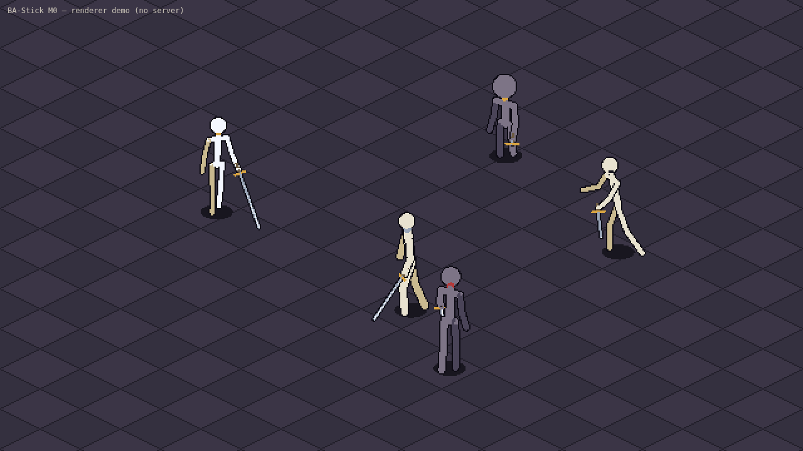

# @bellgrave/stick-web

The new Black Anvil frontend: a thin Vite + TS shell that hosts the Stick Engine
wasm renderer (`engine/ba-stick-render`) on a canvas. Networking, wallet and
chain code come from `@bellgrave/client-core` (wired in M1).

```bash
./engine/build-wasm.sh                     # or: pnpm --filter @bellgrave/stick-web wasm
pnpm --filter @bellgrave/stick-web dev     # http://localhost:5174  (?t=1.5 fast-forwards the demo)
pnpm --filter @bellgrave/stick-web build   # needs the wasm pkg; build:full builds it first
```

M0 shows an offline demo scene (no server): a knight walking a circle, a mage, a
rogue swinging, a pepeka vendor NPC and a mob.


