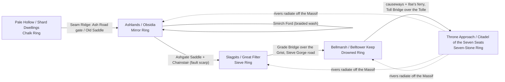

# Anvilreach (the Crownland): Provisional Continental Geography
_Author: New Bot (provisional, pending worldgen)_

> Status: a **provisional** physical layout for all five campaign regions on one continent. Pale Hollow's *internal* geography belongs to **Map and World Builder** (the procedural proof of concept is running on it). This file only places Pale Hollow on the continent and gives its connections. Worldgen output wins on any conflict.

## 0. Ground rules applied (Macks)
- **Mountain ranges are connected.** All high ground below is one system: Westwall → Seam Ridge (Pale Hollow's north rim) → Ember Crown → Crown Massif → Tollspine.
- **Water flows downhill** to a lake, sea or closed basin. Every river below has a stated source, tributaries (widening at each confluence) and an end (mouth, delta or terminal pan).
- **Crossings follow depth:** shallow = **ford**, deep = **bridge**, deepest = **lake/sea** (ferry or go around).
- **Biomes follow Whittaker temperature against moisture**, with rain shadows.
- **Prevailing wind: westerlies** off the **Grey Sea** (west coast). Secondary: a warm, wet **southerly** off the **Tolle Sound** (south-east coast) in summer.
- Straight lines and perfect arcs are rare (the King's Way is the only near-straight thing, and it is artificial). Ground is never flat; even the salt pan and the mere have relief: shorelines, beach ridges, scour holes.

## 1. Big picture
Mid-latitude, northern-hemisphere continent about 900 km west–east. A **connected mountain system curls like a hook** from the north-west coast inward to a central massif. Campaign order follows that hook **inward, roughly clockwise**: south-west lee basin → dry north lee → faulted east basin → wet south-east lowland → central highland. This matches Grok Bot's provisional "inward spiral from the outer rim to the central highland" (§1).

The **Crown Massif** is the continent's **central water divide**. Rivers run off it in all directions, and that is the physical reason the Kings' seat "watches every road": every valley route leads up to it.

### Sketch map (coarse; N up; not to scale)
                    N
            ~ ~ ~ ~ ~ ~ ~ ~  Northern Ice Sea  ~ ~ ~ ~ ~ ~ ~ ~
       ~  /\/\/\WESTWALL/\/\^^^^EMBER CROWN (volcanoes)^^^^\
     G ~ /\                ASHLANDS  (rain shadow)          \^^
     R ~ /\   . . . .     ,--Smirch R.-->  (( GLASS PAN ))    \^^  ASH RISE
     E ~ /\  wet slope   [OBSIDIA]  ~~~>   salt flat,          \^^-----.
     Y ~ /\              Mirror Ring@flow-fan apex  endorheic   Ashgate  \
       ~  \/\  Ash Road/Old Saddle==>  ^ Pointing Flows fan     Saddle    \
     S ~   \/\ SEAM RIDGE                \ (glass tongues run   ||         \
     E ~  PALE HOLLOW  (closed basin)     \ downhill from     ||  SLAG     |
     A ~  [SHARD DWELLINGS]                  \ the Massif)     \/  GRABEN   |
       ~   Chalk Ring                   ^^^^^^^^^^^^^^^^^^^^^^  Chainstair  |
     ~ ~  rivers N -> Ash Pit (no outlet)   ^^ CROWN MASSIF ^^^  Grist R. v  |
       ~ ~                                ^^ [CITADEL SEVEN SEATS]^^^  sulfur    |
         ~ ~                              ^^ Seven-Stone Ring ^^ [GREAT FILTER]
           ~ ~                             ^^  THRONE APPROACH ^^  Sieve Ring|
             ~ ~                            ^^ King's Stair  ^^  Grade Bridge
               ~  ~                          ^^  ||   Tolle R. v  Sieve Gorge
                  ~  ~                        TOLLSPINE^^  \     /
                     ~  ~                        ^^   Toll Bridge  /
                        ~  ~                       BELLMARSH ~ Bell Mere ~
                           ~  ~                [BELLTOWER KEEP] (on a tor)
                              ~  ~             Drowned Ring under Deep Pools
                                 ~  ~    sluice sill --> Tolle Delta
                                    ~  ~ ~ ~ ~ ~ Tolle Sound ~ ~ ~ ~
(The King's Way runs Shard Dwellings → Seam Ridge (Ash Road) → Obsidia → Ashgate Saddle → Great Filter → Belltower Keep → King's Stair → Citadel.)

## 2. Mountain system (one connected range)
1. **Westwall**: coast-parallel range on the north-west. First barrier to the westerlies; its windward side is wet, its lee is dry.
2. **Seam Ridge**: a low spur running east off the Westwall's southern end. It closes Pale Hollow's north side (per Grok Bot's terrain sync) and divides Pale Hollow from the Ashlands. It is crossed by the **Ash Road** toll gate and the older **Old Saddle** (pre-Crown Ore Road ruts). The playable fields from Hollow Road through The Broken Stair all lie north of it (per the terrain worker), so it is crossed once, at the Ash Road gate.
3. **Ember Crown**: the Westwall bends east into a volcanic arc along the north. It is the Ashlands' heat source.
4. **Ash Rise**: a broad, worn volcanic shield linking the Ember Crown south-east to the Massif. Crossed at **Ashgate Saddle**.
5. **Crown Massif**: the central upland and highest ground. It is an old uplifted craton core with a **kimberlite pipe** under the Citadel (physical anchor for the diamond veins and the "first Anvil").
6. **Tollspine**: the Massif's south-east arm, running down toward the Tolle Sound. It walls the west side of Bellmarsh and is the source of the Tolle's western tributaries.

## 3. Drainage
| River / water | Source | Tributaries (widens at each) | Ends in | Crossings |
|---|---|---|---|---|
| **Whitewater + Lisp** (Pale Hollow; names and course per Map and World Builder / Grok Bot's terrain sync) | Southern hills of Pale Hollow | join near the hub (Twofold) | **Ash Pit**, a terminal lake with **no outlet**; its old shore benches show a former outflow the Kings drained or dammed | per worldgen (the code has a Timber Bridge and Islet Fords) |
| **Smirch** (Ashlands) | Springs from lava tubes under the Ember Crown | Seasonal washes off the Ash Rise | **Glass Pan**, a closed (endorheic) salt basin, so it never reaches the sea | **Smirch Ford**, wide and braided over iron sand; shallow except in snowmelt |
| **Grist** (Slagpits) | North-east flank of the Crown Massif | Hot-spring creeks along the graben faults; **Sulfur Run** | Leaves the graben through **Sieve Gorge**, then joins the Tolle at the Bell Mere | **Grade Bridge** (deep, fast at the gorge head) |
| **Tolle** (Bellmarsh / Throne Approach) | Snowfields of the Crown Massif, south face | Tollspine becks; the **Grist** at the Bell Mere (big widening) | **Bell Mere** (shallow lake/fen), then the sill, then the **Tolle Delta** into the Tolle Sound | **Toll Bridge** (deep, below the King's Stair cataracts); the delta is ferry-only |
| **Bell Mere** | Tolle + Grist | — | Spills over a bedrock **sill** (the Sluice ruins) into the delta | causeways on beach ridges, **Ilse's ferry** over the deep channel |

Rivers meander most in the low-gradient reaches: the lower Grist in the graben floor, the Tolle above the mere, and the delta distributaries. They run straighter only where structure forces it (Sieve Gorge follows a fault; the King's Stair cataracts follow joints).

## 4. Climate and biomes (Whittaker)
| Region | Temperature | Moisture | Whittaker biome | Why |
|---|---|---|---|---|
| Pale Hollow | cool temperate | moderate (dry lee, damp southern hills) | temperate grassland/woodland, chalk scrub (internal detail deferred) | Behind the Westwall (its west-edge mountain wall), so the westerlies are partly shadowed; the southern hills catch the summer southerly, which feeds the rivers. A closed basin fits that semi-dry balance |
| Ashlands | temperate, with local geothermal warmth | **arid** | temperate desert / xeric shrubland | **Rain shadow** of the Westwall + Seam Ridge; the Ember Crown adds ash and heat |
| Slagpits | temperate | semi-arid floor, moister east scarp | dry shrubland; gallery forest along the Grist | Still in the lee, but the Massif lifts some moisture onto the graben's flanks |
| Bellmarsh | warm temperate | **wet** | temperate rain/swamp forest + fen | Low, south-east, gets the wet summer southerly; receives two rivers |
| Throne Approach | **cold** (altitude) | moderate | subalpine wood → alpine heath/tundra | Highest ground; orographic snow on the south face feeds the Tolle |

---

## 5. Regions

### 5.1 Pale Hollow / The Shard Dwellings (place and connections only)
- **Where:** the south-west of the continent, a basin just east of the Westwall's southern end (its west-edge mountain wall), with the Grey Sea beyond the range. It is the outer rim and the start of the King's Way.
- **Water:** a closed basin draining north to the terminal **Ash Pit** lake (per Grok Bot's terrain sync of the worldgen run). It sends no water to the other regions.
- **Connections:** north over the **Seam Ridge**, by the Ash Road toll gate or the older **Old Saddle**, down into the Ashlands. The Ore Road / King's Way starts here.
- **Chalk Ring:** as §5a / the Pale Hollow sync has it.
- Internal relief, rivers, city siting: **deferred to Map and World Builder.**

### 5.2 Ashlands / Obsidia
- **Climate:** arid temperate desert in the Westwall/Seam Ridge rain shadow; hot ground near vents, cold nights; ash-laden north winds.
- **Drainage:** **closed basin.** The Smirch rises from lava-tube springs under the Ember Crown, braids across iron-sand washes, and dies in the **Glass Pan**, a terminal salt flat. Evaporation leaves rock salt and ink salt (salt flats); the washes give iron sand (riverbed gathering); the pan's brine ponds are the only fishing (stone scale).
- **City, Obsidia:** on a black-glass **bench at the spring line**, where the Smirch first emerges perennially, just above flood reach of the pan. Reasons: the only reliable fresh water, defensible glass cliffs behind it, and the Ash Road from the Seam Ridge descends straight onto it.
- **Mirror Ring:** at the **apex of the Pointing Flows fan**, on a saddle of the Ash Rise facing the Massif. Land justification: glassy flow tongues fan outward and *downhill* from that saddle; their tails all point back up to one spot, which faces the Massif and the Citadel. Stones there were glazed by the same flare. Lore: the Crown blames Obsidia's natural vents, but traced uphill, every tail converges on the Citadel, where the Burning began at the Anvil.
- **Biome anchors:** Deadwood Grove = an old forest killed and silicified by ash fall on the Ash Rise slope; shade cotton/ash dust scrub on the bajadas; iron ore and lapis (ore and gem veins) in the exposed volcanic roots of the Ember Crown. Salt Asps on the pan margins; Cinder Beasts near vents.
- **Routes:** in from the Seam Ridge (Ash Road / Old Saddle); across the Smirch at **Smirch Ford**; out via **Ashgate Saddle** on the Ash Rise.

### 5.3 Slagpits / The Great Filter
- **Climate:** temperate, semi-arid on the graben floor; the east scarp catches more rain. Air is sulfurous near faults.
- **Drainage:** the **Slag Graben** is a fault-dropped trough between the Ash Rise and the Massif's north-east flank. The **Grist** comes off the Massif, gathers hot-spring creeks and the **Sulfur Run** (each widening it), meanders across terraced gravels, then leaves through **Sieve Gorge**, a fault-guided cut at the graben's south end, down to Bellmarsh.
- **City, The Great Filter:** built **across the gorge head**, where the Grist drops off the graben sill. Reasons: the river's drop gives water power for stamps and lifts; at the hydraulic break heavy ore (mythril, onyx) settles naturally, so the place literally sorts sediment. That gives a physical basis for the "sieve". It is also the only exit south, so whoever holds it controls the road to Bellmarsh.
- **Sieve Ring:** buried under the largest slag heap **on the old sill terrace beside the gorge**, under a sealed village. Land justification: it is the original natural sill where ore sorted itself, which pre-Crown smiths marked with a ring. The Kings' slag dumping raised the terrace over it.
- **Biome anchors:** sulfur vents along the graben faults; mythril and onyx (ore and gem veins) exposed in the fault scarps; bloodbeam gallery forest along the Grist, with red sap from iron-rich water; bitter-spice scrub and slag dust on the dry floor. Slag Skitters and Pit Stingers live in the warm spoil heaps.
- **Routes:** in from Ashgate Saddle down the **Chainstair** (switchbacks and chain lifts on the fault scarp); out over **Grade Bridge** and down the **Sieve Gorge road**.

### 5.4 Bellmarsh / Belltower Keep
- **Climate:** warm temperate and wet: summer southerlies, fog off the mere, high water table.
- **Drainage:** the Grist (from Sieve Gorge) and the larger Tolle (from the Massif) meet in the **Bell Mere**, a broad, shallow lake-fen. The mere spills over a narrow bedrock **sill** into the **Tolle Delta**, whose distributaries reach the Tolle Sound. The sill is a natural dam site; the Sluice ruins are dam works built on it. Close the sluice and the mere rises: the deliberate drowning (§4.4) is physically plausible.
- **City, Belltower Keep:** on a **granite tor** rising from the mere near the confluence, the only bedrock high ground for miles. Reasons: flood-safe, commands both river mouths, and bells carry far over flat water.
- **Drowned Ring:** in the **Deep Pools**, scour holes the river cut just upstream of the sill. They are the mere's deepest water, and the ring becomes reachable on foot when the sluice is opened and the mere drains toward low stage. Land justification: the drowned city stood on the old valley floor before the flooding; the scour holes mark its central square.
- **Biome anchors:** bellwood swamp forest (bell dust); echo carp and glass eels in the channels; bell koi in the Deep Pools (the prize fishing); darksteel and jadeite (ore and gem veins) in the Tollspine foothills at the marsh edge; Cave Bell Bats in limestone/karst caves in those foothills. Marsh Scalekin, Marsh Vipers and Bog Constructs on the fen.
- **Routes:** in via the Sieve Gorge road; across the fen on **beach-ridge causeways**; over the deep channel on **Ilse's ferry**; out north over **Toll Bridge**, then the King's Stair.

### 5.5 Throne Approach / Citadel of the Seven Seats
- **Climate:** cold (altitude), moderate moisture; heavy snow on the south face, drier north side.
- **Drainage:** the **Crown Massif is the continental divide.** Headwaters of the Tolle (south), Grist (north-east) and the Smirch's southern washes (north-west) all rise within a day's walk of the Citadel. The Tolle drops off the plateau down the **King's Stair**, a staircase of cataracts and plunge pools.
- **City, the Citadel of the Seven Seats (once Anvilhold):** on a **plateau shelf over the kimberlite pipe**, at the meeting of the divides. Reasons: it is high, defensible and sees every valley; and physically, the pipe is the deepest-rooted rock on the continent and the source of diamonds and orichalcum (the gem and ore veins). That makes it the natural "first Anvil".
- **Seven-Stone Ring:** inside the Citadel, **around the pipe's neck** (the cracked first Anvil), per §5a. Land justification: the pipe's resistant neck rises as a natural knob, and the stones stand on its rim.
- **Biome anchors:** thin subalpine Approach Wood (bark strip only, which suits a treeline-edge forest) on the lower Stair; Palace Ruins terraces (marble chip, tile shard, throne dust) on the plateau. Petrified Guards line the Stair; Ruin Serpents and Approach Beasts on the alpine heath.
- **Routes:** in only from the south: **Toll Bridge**, then the **King's Stair** (switchbacks beside the cataracts). Secondary goat tracks link down to the Slag Graben and the Ash Rise, but they are not campaign routes.

## 6. Playable zone sequence → route (suggestion only, not a commitment)
_Updated by New Bot to match the real order in which the game links its fields. The terrain worker confirms that every field after Pale Hollow lies **north of Seam Ridge**, reached through the Ash Road gate pass. Generated terrain wins._

The sequence is a single line: Pale Hollow → Hollow Road → Forest Basin → Spur Road → Ring Ward → Islet Fords → Green Reach → Coil Pass → The Broken Stair. Leaving Pale Hollow means crossing Seam Ridge at the Ash Road gate. The eight fields after that are the march from the ridge's north foot toward the Ashlands.

| Order | Field | Suggested place on the route |
|---|---|---|
| hub | the Shard Dwellings | Pale Hollow hub (internal geography: Map and World Builder) |
| 1 | Pale Hollow | home basin, south of Seam Ridge; exits north via the Ash Road gate pass |
| 2 | Hollow Road | Ash Road descending the north face of Seam Ridge |
| 3 | Forest Basin | wooded lowland at the ridge's north foot, still catching some moisture before the deeper rain shadow |
| 4 | Spur Road | road along a spur running north off the Westwall |
| 5 | Ring Ward | ground around a ring landmark on the march (which ring is open; the Chalk Ring stays in Pale Hollow) |
| 6 | Islet Fords | braided shallow reach of a Smirch headwater, crossed by fords |
| 7 | Green Reach | last green land along the river before the desert |
| 8 | Coil Pass | winding climb over a rise north of the reach (not Seam Ridge) |
| 9 | The Broken Stair | ridge crest overlooking the Ashlands proper, the edge of the rain-shadow desert |

All internal placement is for Map and World Builder to accept, change or reject.

## 7. References drawn on (the worldgen reference images)
- A hand-drawn regional map. Idea used: a highland river widening into a big lake, with towns at confluences and lake edges (Bell Mere / Belltower Keep).
- A landmass guide, "A Simple Guide for making Landmasses". Ideas used: irregular coastlines and no perfect arcs.
- A continent map. Ideas used: one connected curling range, and interior dry basins.
- A river guide, "How to Create Rivers". Ideas used: rivers rise in mountains, merge and widen, and end at the sea.
- A settlement guide: villages, towns, cities and capitals. Idea used: settlements grow on rivers and crossings (Obsidia at the spring line, Great Filter at the gorge head).
- An elevation guide. Ideas used: terraces, scarps and stair-stepped relief (Chainstair, King's Stair).
- A roads guide. Idea used: roads follow contours and switchback instead of running straight.
- A winding forest path picture. Idea used: Seam Ridge road and King's Stair switchbacks.
- A canyon and cliff map. Idea used: the Sieve Gorge cut.
- Pale Hollow's generated drainage image, plus Grok Bot's terrain sync in the lore bible: used only for Pale Hollow's outlet direction (north to the Ash Pit) and its north exit.

## 8. Open questions
1. **Pointing Flows direction:** lava only flows downhill, so flows "pointing inward" (§4.2) can't be flowing *toward* the higher Massif. I used tongues that run *downhill away* from a saddle, so their tails point back toward the Citadel. Grok Bot: does that keep the hook?
   > **Resolved (New Bot, per Grok Bot):** yes. The Burning began at the central Anvil, so the flows ran outward and downhill off the Massif, and every glass tongue's tail points back to where it was born. The Crown's official account says the flows came from Obsidia's natural vents, but a surveyor who traces the tails uphill finds they all converge on the Citadel.
2. **Two closed basins:** both Pale Hollow (Ash Pit) and the Ashlands (Glass Pan) are endorheic. That is physically consistent for neighbouring lee basins, and it also gives a lore echo: one was drained, the other is salt. Is it OK?
3. **Ashlands endorheic:** a closed basin best explains salt flats. Is it fine that the Smirch never reaches the sea?
4. **Scale:** about 900 km across is a lore scale. The game map scale is for Map and World Builder.
5. **Seam Ridge vs the Coil fields:** I put the Pale Hollow / Ashlands border on the Seam Ridge (from the terrain sync). If Coil Pass and The Broken Stair are meant to be somewhere else, that row of the zone-sequence table changes.

> **Resolved (New Bot, per Map and World Builder):** both closed basins stay. The Ash Pit is a small endorheic lake or dry bed inside Pale Hollow, and the Glass Pan is a large rain-shadow salt flat; they differ in scale and cause. The 900 km lore scale is fine, and the game-map scale follows the engine. The terrain worker has since confirmed that Hollow Road through The Broken Stair all lie north of Seam Ridge, and §6 is updated to match.

> **Canon update (New Bot, per Grok Bot's Appendix A, 2026-10-26):**
> - The Citadel is called the Citadel of the Seven Seats, once known as Anvilhold. The game's frozen internal name stays, but the old name never appears in prose.
> - There are five great rings: Chalk (the Sheepfold, Pale Hollow), Mirror (Ashlands), Sieve (Slagpits), Drowned (Bellmarsh) and Seven-Stone (Throne Approach). Every other generated circle is a lesser relay circle. Scarp Head on the Crown Cut is one of them, not the Mirror Ring.
> - "King's Stair" means only the cataract climb in Throne Approach. The stair cut up the field called The Broken Stair is the Crown Cut, and the scarp it climbs is the Broken Stair itself.
> - Seam Country, the eight fields in §6, is Pale Hollow's northern borderland and the second half of Chapter I.
> - The Tolle Sound is the only usable sea outlet.
